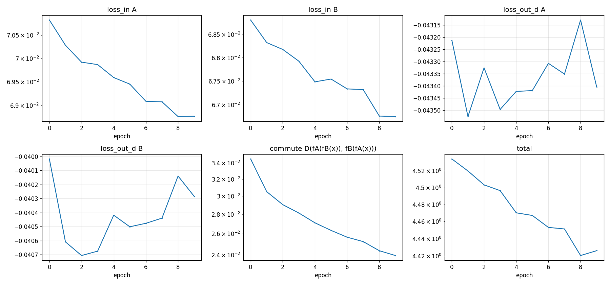
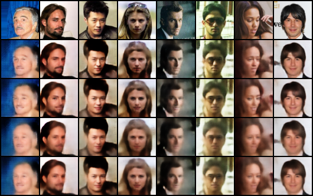
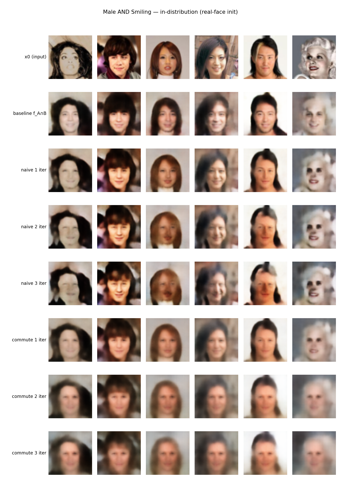
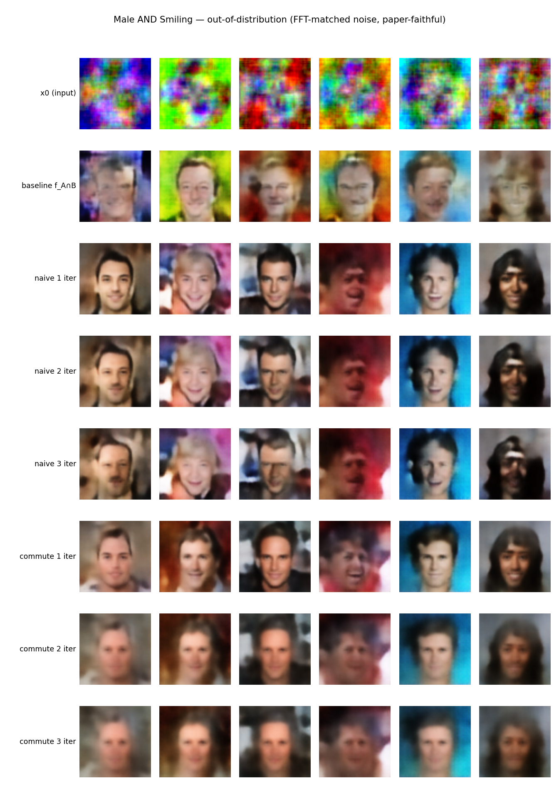

# Commuting IGNs: does training f_A and f_B to commute help alternating projection?

Companion to [README.md](README.md) and [RESULTS.md](RESULTS.md). This documents a
side experiment, not a replacement for the existing pipeline: **the result is
negative** on the metric that matters (joint attribute satisfaction), despite a
real, measurable effect on the metric it was designed to move (order-sensitivity).
Recorded here so the negative result doesn't have to be rediscovered.

## Motivation

`alternating.py` already tests whether two independently-trained IGNs converge
into the intersection of their target sets. Von Neumann's alternating-projection
theorem gives a convergence guarantee for orthogonal projections onto convex
sets, but IGNs are non-linear, oblique, and only approximately idempotent — the
README is explicit that the theorem is "inspiration only".

There is a more specific, checkable version of that guarantee:

> **If `f`, `g` are idempotent and commute** (`f∘g = g∘f`), **then `f∘g` is
> idempotent, and `Fix(f∘g) = Fix(f) ∩ Fix(g)`.**

`f_A` and `f_B` here are each only approximately idempotent (that's what IGN
training optimizes for) and are never trained to commute with each other —
they're trained completely independently, one per attribute. The question this
experiment asks: if we explicitly add a loss term that pushes `f_A` and `f_B`
toward commuting, does alternating projection get measurably closer to the
theorem's guarantee, and does that translate into better joint-attribute
outputs?

## Method: `train_commuting_pair.py`

New script, warm-starts from two already-trained single-attribute checkpoints
(cheap) and fine-tunes them **jointly**, one optimizer over both nets' params,
one combined loss:

```
total = (loss_in_A + loss_out_A + loss_out_d_A)        # keeps f_A anchored to Fix(f_A) = A
      + (loss_in_B + loss_out_B + loss_out_d_B)        # keeps f_B anchored to Fix(f_B) = B
      + lambda_commute * D(f_A(f_B(x)), f_B(f_A(x)))   # pulls them toward commuting
```

The per-network IGN losses are kept deliberately — dropping them would let
`f_A = f_B` trivially satisfy the commute term, collapsing both attribute
projectors into one useless shared function. The commute term is evaluated on
real images from an **unfiltered** pool (not noise, not `A`- or `B`-only),
since `Fix(f∘g) = Fix(f)∩Fix(g)` is a whole-space statement.

```bash
python train_commuting_pair.py \
    --ckpt_a runs/Male_500_withsamples/ckpt_0075.pt \
    --ckpt_b runs/Blond_Hair_500/ckpt_0075.pt \
    --run_name Male_Blond_commuting_probe --num_epochs 10
```

Outputs `ckpt_A_last.pt` / `ckpt_B_last.pt`, drop-in compatible with
`run_experiment.py --models` (arch + attr_spec carried in the checkpoint, same
as `train_ign.py`'s output) — so every existing evaluation script works on them
unchanged.

**`vm_orchestrate.py`** gained a generic `exec <script.py>` / `tail` /
`killscript` command set, for launching one-off scripts like this one on the
VM without them needing to join `vm_experiments.py`'s fixed suite.

**Known limitation:** the script does not persist FFT noise statistics into
its output checkpoints (`train_ign.py` does; this one didn't, originally). Any
`run_experiment.py --init noise` call on a checkpoint from this script falls
back to white noise with a warning, unless `--noise_stats_spec` is also passed
to compute fresh stats from real images. All results below use either real
images or `--noise_stats_spec` for the out-of-distribution condition, not the
checkpoint fallback.

## Experimental setup

Two pairs, warm-started from each attribute's epoch-75 checkpoint (the
"projector stage" — see [TRAINING.md](TRAINING.md), projection strength peaks
early and decays with more training):

- **Male + Smiling** — a normal, non-anti-correlated pair with a real trained
  `f_{A∩B}` baseline already in `runs/Baseline_Male_AND_Smiling`, so it has a
  ground-truth comparison point.
- **Male + Blond_Hair** — the anti-correlated pair `RESULTS.md` already
  documents as failing under every existing method
  (`results/limits/male_blond_tug_of_war_trajectory.png`).

10 epochs each, `lambda_commute=5.0` (untuned — a first probe, not a swept
hyperparameter), L1 for the commute distance `D`.

## Training result: the commute loss does go down

| pair | commute loss, epoch 0 → 9 | each net's own `loss_in` |
|---|---|---|
| Male + Blond_Hair | 0.141 → 0.030 | stable (~0.070 / ~0.090), no collapse |
| Male + Smiling | 0.072 → 0.024 | stable (~0.069 / ~0.068), no collapse |




Both networks' own attribute-projection losses stay flat and distinct
throughout — the guard against `f_A = f_B` collapse worked. Final sample
grids (rows: `x`, `f_A(x)`, `f_B(x)`, `f_A(f_B(x))`, `f_B(f_A(x))`):




## Evaluation result: order-sensitivity drops, but joint attribute rate doesn't improve

Order-sensitivity (`run_experiment.py`'s `order_disagreement`, pixel-distance
between the limits of `f_A∘f_B` vs `f_B∘f_A`) is the direct test of the
theorem's premise, and it *did* improve — most clearly with real-face
initialization, less so with noise:

| pair, init | order distance |
|---|---|
| Male+Blond, noise (checkpoint fallback → white) | 39.0 |
| Male+Blond, real images | 9.5 → 4.4 (at `--num_iters 1`, the project's documented optimum) |
| Male+Smiling, noise (checkpoint fallback → white) | 47.2 |
| Male+Smiling, real images | 7.0 → 3.5 (at `--num_iters 1`) |

But **the metric that actually matters — joint attribute satisfaction — tells
a different story**, once compared head-to-head against plain alternating
projection with no commute loss at all (both pairs' original independently-
trained checkpoints, same `f_A`/`f_B`, no fine-tuning). Full comparison for
Male+Smiling: baseline (real trained-on-intersection model), naive alternating
at 1/2/3 composition iterations, and the commuting-trained pair at 1/2/3
iterations — tested both in-distribution (real-face init) and out-of-
distribution (FFT frequency-matched noise, the paper-faithful noise type per
`TRAINING.md`, not plain white noise):

| method | in-dist. joint rate | out-of-dist. joint rate |
|---|---|---|
| baseline (`f_{A∩B}`, trained directly) | 0.59 | 0.91 |
| naive, 1 iter | 0.22 | 0.58 |
| naive, 2 iter | 0.30 | 0.46 |
| naive, 3 iter | 0.42 | 0.48 |
| commuting-trained, 1 iter | 0.22 | 0.47 |
| commuting-trained, 2 iter | 0.17 | 0.27 |
| commuting-trained, 3 iter | 0.05 | 0.12 |
| (classifier ceiling, real A∩B photos) | 0.85 | 0.85 |

**Naive alternating (no commute loss) beats the commuting-trained pair at
every iteration depth, in both domains** — and the commuting-trained pair gets
*worse* with more composition iterations while naive alternating holds
roughly flat or improves. Visually:




(Rows top→bottom: `x_0`, the real baseline, naive 1/2/3 iters, commuting
1/2/3 iters — same input faces across every row.)

## Conclusion

At this scale — 10 epochs, `lambda_commute=5` untuned, one warm-started pair
per condition — **training f_A and f_B to commute measurably reduces
order-sensitivity (the theorem's actual premise) but does not improve, and
in fact appears to hurt, joint attribute satisfaction relative to doing
nothing extra.** The likely explanation: the extra fine-tuning epochs pull
each checkpoint away from its epoch-75 "projector sweet spot"
(`TRAINING.md`), trading individual projection strength for a small gain in
mutual agreement between orders — a bad trade given the theorem's guarantee
only helps if the two functions are *also* still good, sharp projectors onto
their own target sets.

This is a real, reproducible negative result on the specific setup tested
(untuned λ, short fine-tune, epoch-75 warm start), not a proof the idea can't
work — a longer run, a lower `lambda_commute` (less disruption to each net's
own projector quality), or training from scratch as a genuinely joint
pipeline (rather than warm-started fine-tuning) are all still open. Recording
it here so the next attempt starts from this, instead of re-deriving it.

## Reproducing this

```bash
# fine-tune a pair to commute (warm-started, cheap)
python train_commuting_pair.py --ckpt_a <ckpt> --ckpt_b <ckpt> --run_name <name> --num_epochs 10

# evaluate: real-image init (in-distribution)
python run_experiment.py --models <ckptA> <ckptB> --names f_A f_B \
    --baseline <baseline_ckpt> --intersection_spec "<A>,<B>" \
    --init real --num_iters 1 --num_samples 256 --skip_fid --tag <name>

# evaluate: paper-faithful FFT-matched noise (out-of-distribution),
# independent of whether the checkpoint has freq_stats saved
python run_experiment.py --models <ckptA> <ckptB> --names f_A f_B \
    --baseline <baseline_ckpt> --intersection_spec "<A>,<B>" \
    --init noise --noise_stats_spec all --num_iters 1 --num_samples 256 --skip_fid --tag <name>
```

On the shared VM: `python vm_orchestrate.py exec train_commuting_pair.py -- <args>`,
then `python vm_orchestrate.py tail train_commuting_pair.py`.
