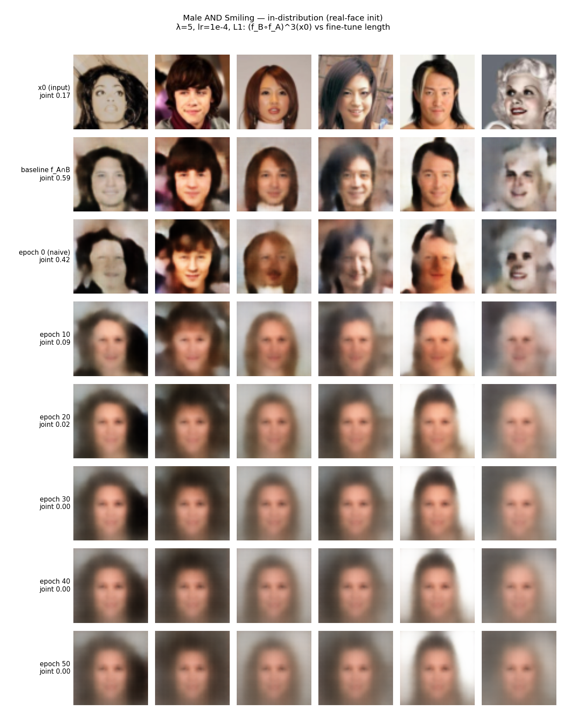
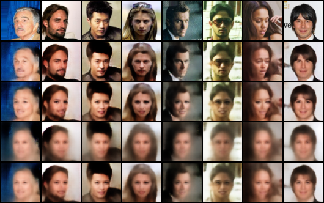
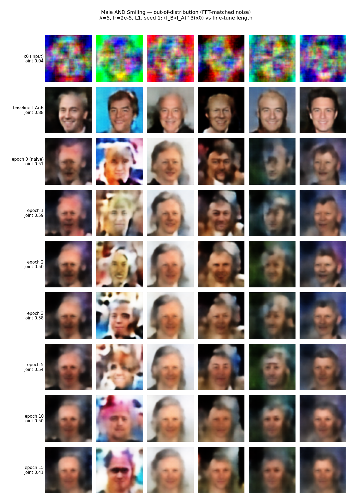
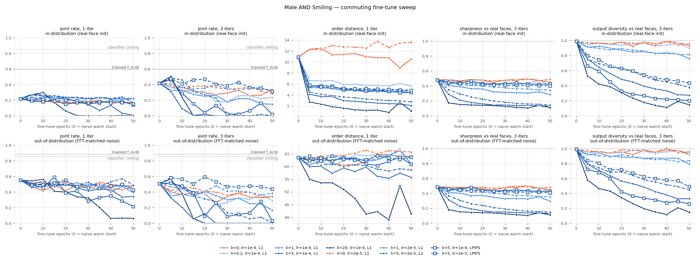
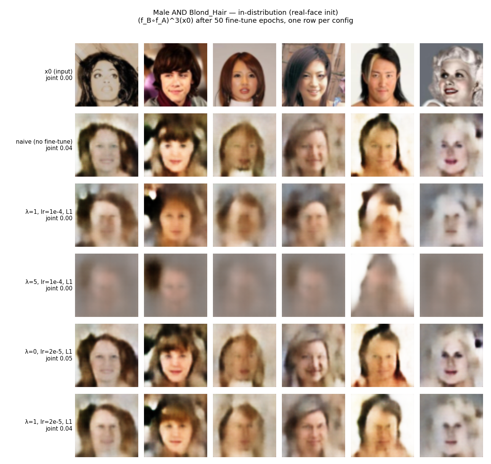

# Commuting-loss sweep: hyperparameters and fine-tune length

Follow-up to [COMMUTING_LOSS_EXPERIMENT.md](COMMUTING_LOSS_EXPERIMENT.md), which
left three things open: `lambda_commute` was untuned (5.0), fine-tuning was
short (10 epochs), and the commute distance was L1 only. This sweep covers all
three: 11 fine-tuning runs on Male+Smiling and 4 on Male+Blond_Hair, up to 50
epochs each, with a snapshot every 5 epochs (every epoch for one run), about
15 GPU-hours on one A10.

**Bottom line.**
- **Longer fine-tuning makes it worse.** Every config with a commute term
  (λ > 0) ends up mapping all inputs onto one shared face.
- **The commute term causes this, not the extra fine-tuning.** λ = 0 controls
  on the same schedule don't collapse.
- **There is one small, reproducible gain:** fine-tuning for 1–5 epochs at
  λ = 5, lr = 2e-5 raises the in-distribution joint rate by about +0.05 at
  every iteration depth, with image quality unchanged (KID). The effect
  appeared on two training seeds and was confirmed on 1024 fresh inputs.
- **No gain out of distribution, and none on the anti-correlated Male+Blond
  pair.**
- **Nothing tested gets near the trained f_A∩B baseline.**

## What changed in the code

| file | change |
|---|---|
| `train_commuting_pair.py` | keeps a `ckpt_{A,B}_eNNNN.pt` snapshot at every `--save_every` epochs (NNNN = epochs completed), so one long run can be evaluated at many fine-tune lengths; data loaders no longer go through `itertools.cycle`, which cached every batch it yielded in RAM |
| `commuting_sweep.py` (new) | trains a JSON spec of runs one after another and evaluates each as it finishes; resumable (skips runs whose final snapshot exists) |
| `commuting_sweep_eval.py` (new) | evaluates naive + every snapshot on **one fixed x₀** per domain, see below |
| `make_commuting_grids.py` (new) | the image grids in the original layout, plus sweep-overview / epoch-progression grids and metric curves |
| `commuting_sweep_*.json` (new) | the sweep specs actually run |

## Evaluation

The same two domains as before: **in-distribution** (256 real CelebA test faces)
and **out-of-distribution** (256 FFT-matched noise samples, stats from train
images). Both are fixed and shared across every checkpoint. All iterates are
`(f_B∘f_A)^n(x₀)`, n = 1, 2, 3, with train-mode BatchNorm over the whole batch,
as in `run_experiment.py`. On the original checkpoints this reproduces the
earlier numbers exactly: naive 0.22 / 0.30 / 0.42, probe 0.22 / 0.17 / 0.05.

The metrics:

| metric | meaning |
|---|---|
| joint rate | classifier says Male ∧ Smiling (the headline in the earlier doc) |
| order distance | ‖(f_B f_A)(x₀) − (f_A f_B)(x₀)‖, the theorem's premise |
| sharpness | mean \|Laplacian\| relative to real faces |
| diversity | per-pixel std across the batch over the central face crop, relative to real faces; ~0 when every input lands on the same face |
| KID | Inception-feature distance to real Male ∧ Smiling test photos (final robustness pass only) |

**Why KID.** The classifier happily labels one blurry prototype face as
"Male ∧ Smiling", so a collapsing pair can *raise* the joint rate. An example
is λ = 20 at epoch 5 below: joint 0.57, but every output is the same smudge.
KID can't be gamed that way. Sharpness alone isn't enough either, because the
LPIPS variant collapses onto a *sharp* face. Diversity catches both.

## Result 1: more epochs make it strictly worse

The original config (λ = 5, lr = 1e-4, L1) extended from 10 to 50 epochs:

| epochs | in-dist joint (1 / 2 / 3 iter) | OOD joint (1 / 2 / 3) | order dist | diversity (3 iter) |
|---|---|---|---|---|
| 0 (naive) | 0.22 / 0.30 / 0.42 | 0.55 / 0.50 / 0.51 | 10.9 | 0.99 |
| 5 | 0.28 / 0.34 / 0.32 | 0.51 / 0.39 / 0.33 | 4.1 | 0.76 |
| 10 (the original probe length) | 0.27 / 0.20 / 0.09 | 0.53 / 0.32 / 0.20 | 3.7 | 0.64 |
| 25 | 0.18 / 0.00 / 0.00 | 0.45 / 0.07 / 0.00 | 2.9 | 0.45 |
| 50 | 0.01 / 0.00 / 0.00 | 0.34 / 0.00 / 0.00 | 2.1 | 0.27 |



Order distance keeps falling, so the commute loss is doing its job. But it gets
there by collapsing: by epoch 50 every input maps to the same blurry mean face.

## Result 2: the commute term causes it, not the fine-tuning

λ = 0 controls use the same schedule and the same joint optimizer, only
without the commute term:

| config (epoch 50) | in-dist joint (1 / 3) | OOD joint (3) | order dist | diversity |
|---|---|---|---|---|
| naive | 0.22 / 0.42 | 0.51 | 10.9 | 0.99 |
| λ = 0, lr = 1e-4 | 0.18 / 0.34 | 0.34 | 10.5 | 0.93 |
| λ = 0, lr = 2e-5 | 0.16 / 0.29 | 0.34 | 13.6 | 0.96 |
| λ = 5, lr = 1e-4 | 0.01 / 0.00 | 0.00 | 2.1 | 0.27 |

Plain fine-tuning drifts slowly downhill, the expected drift away from the
epoch-75 "projector sweet spot" (`TRAINING.md`). It stays sharp and varied,
and order distance doesn't move. Only the commute term collapses the outputs.

## Result 3: how it fails — both compositions agree on one face

The training-time sample grid for λ = 5 at epoch 49 has rows x, f_A(x),
f_B(x), f_A(f_B(x)) and f_B(f_A(x)):



Each net alone still works on real faces (rows 2–3 are sharp, and each net's
`loss_in` even improves slightly, 0.071 → 0.064). What collapses is each net's output **when
it is fed the other net's output** (rows 4–5).

The per-network IGN losses only constrain f_A on A-images and on noise.
Nothing constrains it on f_B's output range. So the cheapest way to make
`f_A∘f_B ≈ f_B∘f_A` is for both to send those inputs to one shared image.

The distance metric only changes *which* image:
- **L1** rewards a blurry mean face.
- **LPIPS** rewards a sharp "mask" face (dark eyes, red nose and mouth) that
  AlexNet features agree on, with diversity down to 0.20 while sharpness still
  reads 0.43.


## Result 4: the classifier rewards collapse

λ = 20 at epoch 5 posts one of the sweep's highest out-of-distribution joint
rates, 0.55 / 0.57 at 2 / 3 iterations against naive's 0.50 / 0.51. Yet every
output is the same smudge (diversity 0.58, KID 16–20 vs naive's 5–7):


So any joint-rate "gain" that comes with falling diversity is not a real gain.
The final comparison below therefore reads joint rate and KID together.

## Result 5: the one real gain — 1–5 epochs at λ = 5, lr = 2e-5

Lower lr slows the collapse enough that an early window opens up.

**Replication.** A second training seed was run with a snapshot every epoch.
Then the key checkpoints were re-evaluated on a **fresh, larger x₀** (1024
images, different seed) with KID. In the table below lower KID is better, and
KID is ×100.

| checkpoint | in-dist joint (1 / 2 / 3) | in-dist KID (1 / 2 / 3) | OOD joint (1 / 2 / 3) | OOD KID (1 / 2 / 3) | order dist |
|---|---|---|---|---|---|
| naive | 0.22 / 0.32 / 0.40 | 8.0 / 8.3 / 9.9 | 0.54 / 0.46 / 0.48 | 4.5 / 5.3 / 6.8 | 10.9 |
| λ = 0, lr = 2e-5, epoch 5 (control) | 0.21 / 0.29 / 0.35 | 8.2 / 10.5 / 13.4 | 0.47 / 0.36 / 0.39 | 4.9 / 6.6 / 9.8 | 12.3 |
| **λ = 5, lr = 2e-5, epoch 1** (seed 1) | **0.27 / 0.38 / 0.46** | **7.8 / 8.0 / 9.1** | 0.53 / 0.50 / 0.50 | 6.0 / 6.9 / 7.8 | 5.4 |
| λ = 5, lr = 2e-5, epoch 3 (seed 1) | 0.26 / 0.41 / 0.48 | 7.9 / 8.9 / 10.9 | 0.51 / 0.48 / 0.50 | 5.3 / 6.7 / 8.6 | 4.8 |
| λ = 5, lr = 2e-5, epoch 5 (seed 0) | 0.26 / 0.40 / 0.45 | 8.2 / 9.9 / 12.6 | 0.47 / 0.43 / 0.45 | 4.9 / 6.9 / 9.5 | 4.5 |
| λ = 5, lr = 2e-5, epoch 10 (seed 1) | 0.28 / 0.40 / 0.48 | 8.8 / 11.9 / 15.4 | 0.48 / 0.42 / 0.47 | 5.3 / 8.8 / 12.8 | 4.1 |
| λ = 1, lr = 2e-5, epoch 5 | 0.23 / 0.35 / 0.38 | 7.6 / 8.6 / 11.4 | 0.44 / 0.39 / 0.39 | 4.8 / 5.9 / 8.4 | 5.7 |
| LPIPS λ = 5, lr = 2e-5, epoch 5 | 0.24 / 0.38 / 0.46 | 8.2 / 10.6 / 13.2 | 0.48 / 0.50 / 0.53 | 5.6 / 7.8 / 10.4 | 5.8 |
| λ = 20, lr = 1e-4, epoch 5 | 0.28 / 0.38 / 0.46 | 12.7 / 18.0 / 21.2 | 0.52 / 0.48 / 0.56 | 8.5 / 16.0 / 20.3 | 2.7 |
| trained f_A∩B baseline | 0.58 | 6.6 | 0.91 | 3.4 | — |
| real Male ∧ Smiling photos (classifier ceiling) | 0.87 | — | 0.87 | — | — |

**In distribution, one epoch of commute fine-tuning is a clean improvement.**
- **Joint rate:** up +0.05–0.06 at every depth. Treating the two sets of
  1024 outputs as independent, that is about 2.5–3 standard errors. The
  inputs are actually paired, which would tighten this, but no paired test
  was run.
- **KID:** equal or slightly *better* than naive.
- **Order distance:** halved.
- **Controls:** the matched λ = 0 control shows no gain.
- **Both seeds agree:** seed 0 at epoch 5 and seed 1 at epochs 1–10 give the
  same joint rates.
- **After that, quality erodes:** KID climbs with every further epoch.

**Out of distribution it is a wash.** The joint rate is about the same as
naive, and KID is somewhat worse.




## The full Male+Smiling sweep

All values below use the 256-image x₀. Each cell reads: in-dist joint (1 / 3
iter) | OOD joint (3 iter) | order dist | diversity (3 iter).

| config | epoch 5 | epoch 50 |
|---|---|---|
| naive | 0.22 / 0.42 \| 0.51 \| 10.9 \| 0.99 | |
| λ = 0, lr = 1e-4 | 0.21 / 0.37 \| 0.40 \| 12.4 \| 0.95 | 0.18 / 0.34 \| 0.34 \| 10.5 \| 0.93 |
| λ = 0, lr = 2e-5 | 0.19 / 0.41 \| 0.41 \| 12.3 \| 0.97 | 0.16 / 0.29 \| 0.34 \| 13.6 \| 0.96 |
| λ = 0.2, lr = 1e-4 | 0.20 / 0.36 \| 0.38 \| 6.7 \| 0.95 | 0.23 / 0.23 \| 0.29 \| 5.7 \| 0.90 |
| λ = 1, lr = 1e-4 | 0.18 / 0.33 \| 0.35 \| 5.4 \| 0.91 | 0.21 / 0.15 \| 0.17 \| 4.4 \| 0.76 |
| λ = 1, lr = 2e-5 | 0.24 / 0.39 \| 0.47 \| 5.7 \| 0.91 | 0.23 / 0.33 \| 0.38 \| 4.8 \| 0.81 |
| λ = 5, lr = 1e-4 | 0.28 / 0.32 \| 0.33 \| 4.1 \| 0.76 | 0.01 / 0.00 \| 0.00 \| 2.1 \| 0.27 |
| λ = 5, lr = 2e-5 | 0.27 / 0.48 \| 0.50 \| 4.5 \| 0.75 | 0.17 / 0.00 \| 0.00 \| 2.8 \| 0.38 |
| λ = 20, lr = 1e-4 | 0.27 / 0.50 \| 0.57 \| 2.7 \| 0.53 | 0.00 / 0.00 \| 0.00 \| 1.1 \| 0.15 |
| LPIPS λ = 5, lr = 1e-4 | 0.19 / 0.46 \| 0.52 \| 5.6 \| 0.66 | 0.14 / 0.02 \| 0.03 \| 4.5 \| 0.20 |
| LPIPS λ = 5, lr = 2e-5 | 0.22 / 0.48 \| 0.58 \| 5.8 \| 0.80 | 0.15 / 0.32 \| 0.44 \| 4.9 \| 0.44 |

The pattern across the whole sweep:
- Any λ ≥ 0.2 roughly halves order distance within 5 epochs.
- Higher λ or higher lr make the collapse come sooner.
- Lower lr is the knob that buys a usable early window.




Per-snapshot numbers are in
[ms_sweep_results.csv](results/commuting_loss_sweep/ms_sweep_results.csv) and
[ms_robust_n1024_kid_results.csv](results/commuting_loss_sweep/ms_robust_n1024_kid_results.csv).

## Male + Blond_Hair: no help, and the commute term changes which attribute wins

This is the anti-correlated pair. The classifier recognizes only **0.27** of
real male-blond photos as both, so joint rates here are small at best. The
table shows 3-iteration in-distribution rates.

| config | joint | Male | Blond | order dist | diversity |
|---|---|---|---|---|---|
| naive | 0.04 | 0.09 | 0.46 | 19.0 | 0.80 |
| λ = 0, lr = 2e-5, epoch 50 | 0.05 | 0.18 | 0.38 | 17.2 | 0.86 |
| λ = 1, lr = 2e-5, epoch 50 | 0.04 | 0.48 | 0.12 | 6.5 | 0.78 |
| λ = 1, lr = 1e-4, epoch 50 | 0.00 | 0.70 | 0.00 | 5.1 | 0.72 |
| λ = 5, lr = 1e-4, epoch 5 | 0.01 | 0.59 | 0.05 | 5.4 | 0.61 |
| λ = 5, lr = 1e-4, epoch 50 | 0.00 | 0.88 | 0.01 | 1.6 | 0.26 |

Naive alternation ends mostly blond and not male. With the commute term the
tug-of-war flips: Male wins and blond disappears. The pair commutes by one
projector yielding to the other, not by finding the intersection, and at
λ = 5 the same blur collapse follows.



## Correction to COMMUTING_LOSS_EXPERIMENT.md

That doc's order-distance table reads "Male+Smiling, real images: 7.0 → 3.5",
which looks like naive → commuting. It is actually the commuting-trained pair
at 20 iterations vs at 1 iteration (from `exp_results/Male_Smiling_commuting_eval*.log`).
Naive was never measured there. On the same x₀ naive is **10.9** (Male+Smiling)
and **19.0** (Male+Blond), so the drop from commute training is larger than
that doc implies: 10.9 → 3.5 and 19.0 → 4.4.

## Conclusion and what to try next

Training f_A and f_B to commute does make them commute. But with only the
per-network IGN losses as anchors, the commute term is satisfied mostly
through a degenerate shortcut: both compositions send each net's outputs to
one shared image.

The useful regime is a **very short, low-lr fine-tune: 1–5 epochs at λ = 5,
lr = 2e-5**. There it buys a real but modest in-distribution gain before the
shortcut takes over. More epochs are strictly worse. Even at its best, the
pair stays far from a network trained directly on the intersection
(0.27 / 0.38 / 0.46 vs 0.58).

Directions this points to, none of them tried yet:

- **Anchor the cross outputs.** Apply each net's IGN losses (idempotence +
  tightness) to the *other* net's outputs too, so that `f_A(f_B(x))` is held
  to f_A's own projection behaviour instead of being free to collapse.
- **Early-stop on diversity or KID**, not on the commute loss, which keeps
  falling straight through the collapse.
- **Rule out batch-statistics shortcuts.** The commute term sees batches of
  the other net's outputs, whose BatchNorm statistics differ from real images.
  Mixing real and composed images in one batch would test whether the nets are
  keying on that.

## Reproducing

```bash
# the sweep (trains + evaluates; resumable) -- ~90 s/epoch Male+Smiling, ~32 s/epoch Male+Blond on an A10
python commuting_sweep.py --spec commuting_sweep_male_smiling.json
python commuting_sweep.py --spec commuting_sweep_male_smiling_followup.json
python commuting_sweep.py --spec commuting_sweep_male_blond.json

# figures
python make_commuting_grids.py --eval_dir exp_results/commuting_sweep/male_smiling --comparison_epochs 5 10 50
python make_commuting_grids.py --eval_dir exp_results/commuting_sweep/male_blond \
    --pair_label "Male AND Blond_Hair" --comparison_epochs 5 10 50

# robustness pass: fresh 1024-image x0 + KID vs real Male-and-Smiling photos
python commuting_sweep_eval.py --kid --num_samples 1024 --seed 1 \
    --naive_a runs/Male_500_withsamples/ckpt_0075.pt --naive_b runs/Smiling_paper500/ckpt_0075.pt \
    --baseline runs/Baseline_Male_AND_Smiling/ckpt_last.pt --intersection_spec "Male,Smiling" \
    --runs runs/ms_l1_lam0_lr2e-5 runs/ms_l1_lam5_lr2e-5 runs/ms_l1_lam5_lr2e-5_s1_fine ... \
    --epochs 1 2 3 5 10 --out exp_results/commuting_sweep/male_smiling_robust
```
