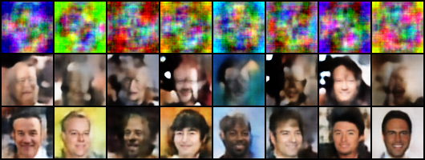

# Projection onto Intersections of Target Manifolds with IGNs

MCV course project. An Idempotent Generative Network (IGN, Shocher et al.,
ICLR 2024) projects noise onto the manifold of its training data. We ask
whether IGNs can project onto an **intersection** of such manifolds, A ∩ B,
using CelebA attributes as the sets (for example A = Male, B = Smiling), and
compare three ways of doing it.

Built on the reference implementation of Shocher et al.; the IGN losses are
preserved exactly (see [docs/PIPELINE.md](docs/PIPELINE.md#relationship-to-upstream-ign-main-and-the-paper)).

## The three methods

| | Idea | Code | Write-up |
|---|---|---|---|
| **1. Single IGN** (baseline) | Train one IGN directly on A ∩ B. | [`train/train_ign.py`](train/train_ign.py) with a multi-attribute spec; comparison in [`experiments/method1_single_ign/`](experiments/method1_single_ign/) | [RESULTS.md](docs/RESULTS.md) |
| **2. Alternating IGNs** | Train f_A and f_B separately, then iterate x ← f_A(f_B(x)), inspired by von Neumann's alternating projections. | [`ign/alternating.py`](ign/alternating.py), [`experiments/method2_alternating/`](experiments/method2_alternating/) | [RESULTS.md](docs/RESULTS.md), [method2_iterations.md](docs/method2_iterations.md), [method2_order.md](docs/method2_order.md) |
| **3. Commutative IGNs** | Fine-tune f_A and f_B jointly with a loss that makes them commute; commuting idempotents compose to a projection onto Fix(f_A) ∩ Fix(f_B). | [`train/train_commuting_pair.py`](train/train_commuting_pair.py), [`experiments/method3_commuting/`](experiments/method3_commuting/) | [method3_commuting.md](docs/method3_commuting.md) |

## Results in brief

Headline pair: **Male ∧ Smiling** (CelebA, 64×64).



*Rows: starting noise, alternating f_Male and f_Smiling, the trained
f_Male∩Smiling baseline.*

- **Method 1.** The trained intersection baseline reaches a 0.91 joint
  attribute rate at FID 51. It is the strongest method on joint rate, but
  needs enough A ∩ B training data and a new network per combination.
- **Method 2.** Zero-shot pipelines built only from single-feature IGNs reach
  baseline-level realism: relaxed alternation scores 0.55 joint at FID 52,
  per-image adaptive stepping 0.67 at FID 50, and generate-and-select 100%
  joint at FID 47 with a 55% yield ([RESULTS.md](docs/RESULTS.md)).
  - **More cycles do not help.** One or two cycles are best; further
    alternation mostly blurs, and the iteration settles near, not on, a joint
    fixed point ([method2_iterations.md](docs/method2_iterations.md)).
  - **Order matters from noise, not from real faces.** The first network
    decides the face, so the sharper projector (f_Male) should go first
    ([method2_order.md](docs/method2_order.md)).
  - **Feature compatibility decides success.** Anti-correlated pairs
    (Male + Blond) fail under every method; compatible triples and quads
    scale gracefully.
- **Method 3.** The commute loss does make the networks commute, but mostly
  by mapping inputs onto one shared face. A very short, low-lr fine-tune
  (1–5 epochs, λ = 5, lr = 2e-5) gives a small in-distribution gain (about
  +0.05 joint rate); nothing tested approaches the Method 1 baseline
  ([method3_commuting.md](docs/method3_commuting.md)).

## Repository layout

```
ign/                        shared library
  data.py                   CelebA loading + attribute-subset filtering (A, B, A∩B)
  models.py                 IGN architectures + attribute classifier
  utils.py                  IGN losses, DDP/device helpers, FFT-matched noise
  alternating.py            the alternating iteration + convergence diagnostics
  metrics.py                attribute rates, FID/KID, LPIPS/SSIM/PSNR
train/                      train_ign.py, train_classifier.py, train_commuting_pair.py
experiments/
  method1_single_ign/       run_experiment.py (alternation vs baseline), make_figures.py
  method2_alternating/      iterations.py, order study, relaxation / league / scaling evaluators
  method3_commuting/        commuting-loss sweep runner, evaluator, figures
  per_network/              single-network analysis (checkpoint curves, negatives, polish)
  configs/                  experiment configs and the campaign's batch files
results/                    curated figures and numbers, one folder per method
docs/                       write-ups (see below)
scripts/                    data setup, attribute inspection, smoke/integration tests
infra/                      GPU-VM orchestration and the multi-node cluster launcher
archive/                    one-off campaign helpers, kept for the record
```

## Quick start

Run everything **from the repository root**; scripts are modules, run with
`python -m`.

```bash
pip install torch torchvision matplotlib numpy
# optional: pip install lpips wandb gdown

python scripts/smoke_test.py          # verify the code (no CelebA needed)
python scripts/integration_test.py    # verify the whole pipeline (no CelebA needed)
```

Then put CelebA under `data/celeba/` (see [scripts/README_data.md](scripts/README_data.md)) and:

```bash
python scripts/inspect_attributes.py                  # pick a viable feature pair
bash scripts/run_pipeline.sh                          # train + run Methods 1 and 2 end to end
ATTR_A=Male ATTR_B=Smiling NPROC=4 bash scripts/run_pipeline.sh   # 4 GPUs

# with trained checkpoints in runs/:
python -m experiments.method2_alternating.iterations --init real   # Method 2, K-cycle study
```

Trained weights are not in the repository (they stay on the training machine).

## Documentation

| Document | Contents |
|---|---|
| [docs/RESULTS.md](docs/RESULTS.md) | the main experimental campaign: Methods 1 and 2, empirical laws, scaling past two features |
| [docs/method2_iterations.md](docs/method2_iterations.md) | Method 2: effect of the number of cycles K, and of the order, judged visually |
| [docs/method2_order.md](docs/method2_order.md) | Method 2: order-of-application study with statistics |
| [docs/method3_commuting.md](docs/method3_commuting.md) | Method 3: commuting-loss experiment and hyperparameter sweep |
| [docs/TRAINING.md](docs/TRAINING.md) | how to train an IGN and tune its hyperparameters |
| [docs/PIPELINE.md](docs/PIPELINE.md) | running each phase by hand, attribute specs, reading the diagnostics, caveats, relation to upstream |
