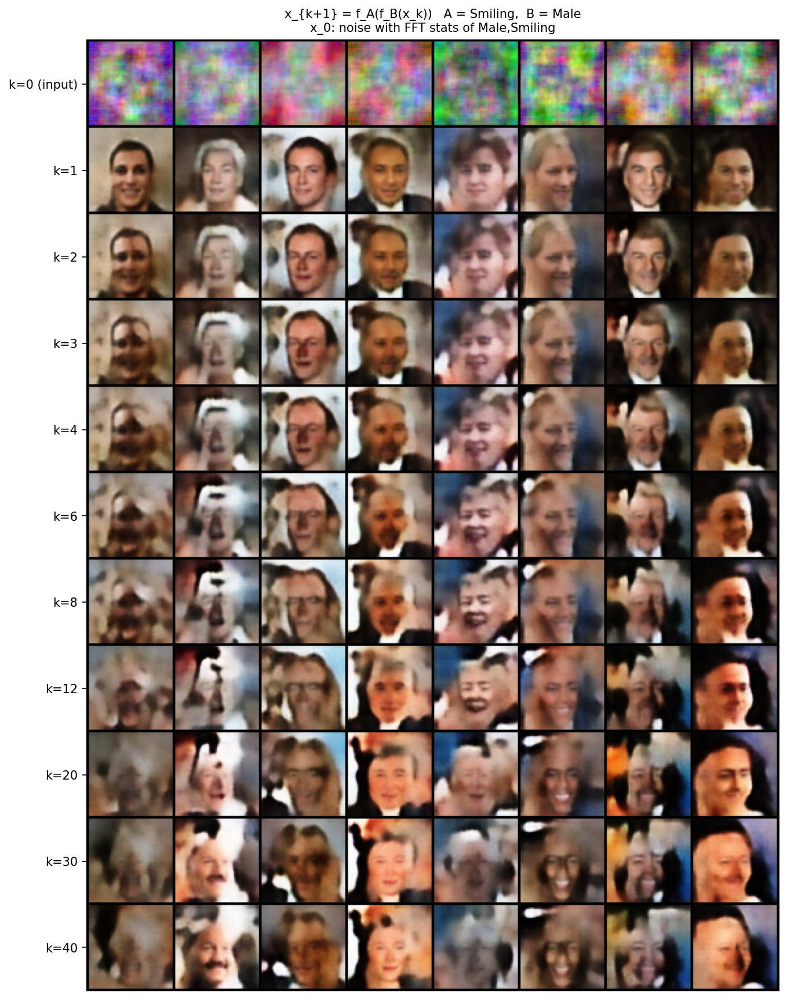
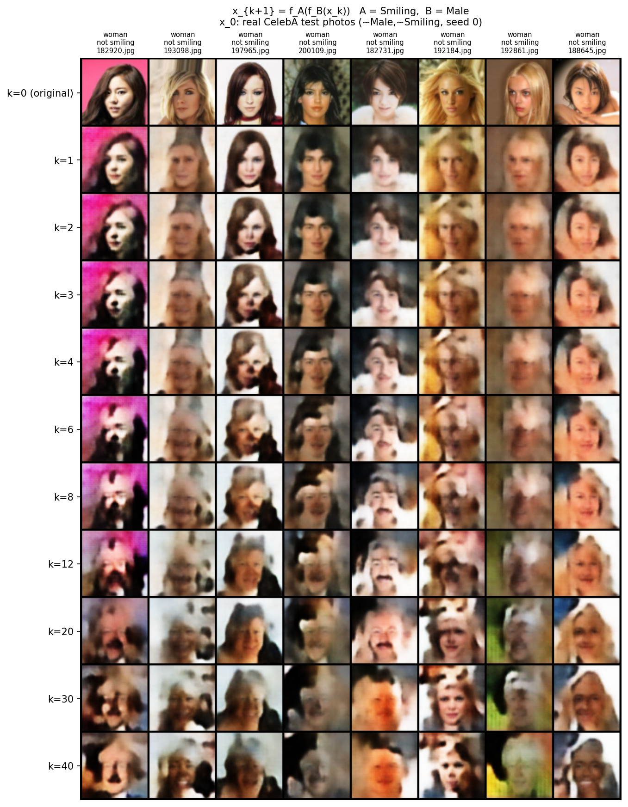
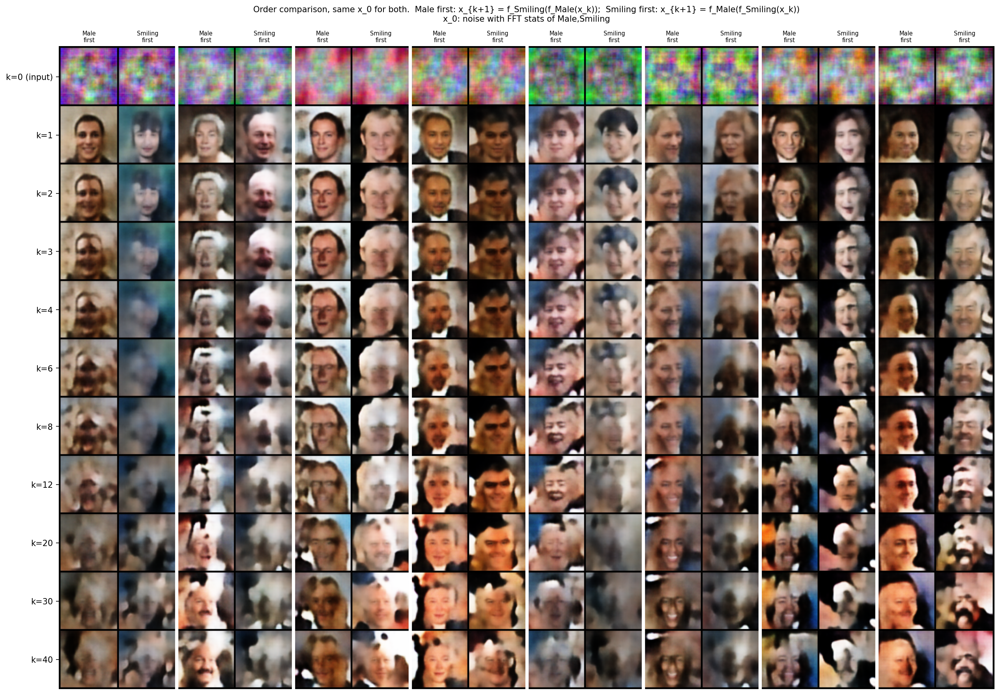
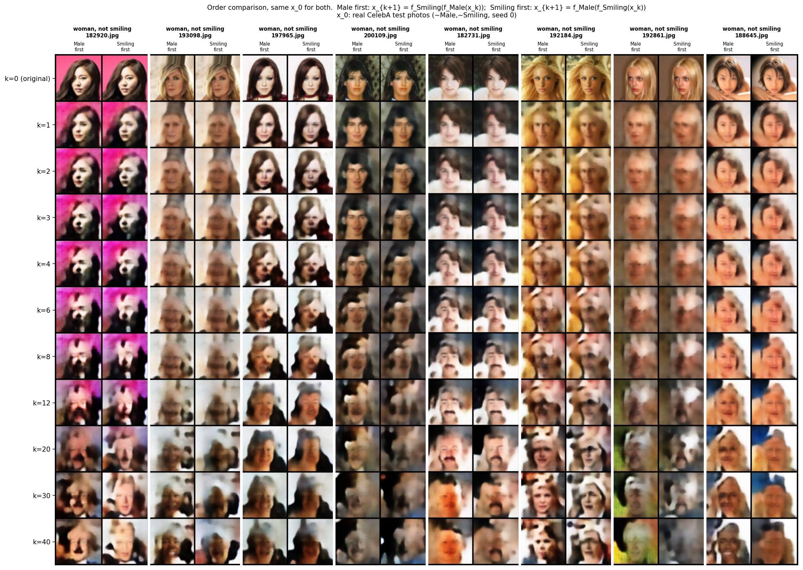

# Method 2: how the number of alternating cycles K affects the output

Part of Method 2 (proposal §3.2): two independently trained IGNs applied in
turn, `x_{k+1} = f_Smiling(f_Male(x_k))`, for up to K = 40 cycles. The
question is what more cycles do to the image, and whether the order of the two
networks matters. Results are judged **visually** from image grids; the
convergence diagnostics are recorded alongside but are not the criterion.

Script: [`experiments/method2_alternating/iterations.py`](../experiments/method2_alternating/iterations.py).

## Setup

| | |
|---|---|
| Pair | f_Male = `Male_500_withsamples/ckpt_0075`, f_Smiling = `Smiling_paper500/ckpt_0025` (the projector checkpoints used throughout [RESULTS.md](RESULTS.md)) |
| Default order | f_Male first, then f_Smiling |
| Noise start | FFT-matched noise with the statistics of 256 Male ∧ Smiling train images, as in RESULTS.md |
| Real start | the team's shared CelebA test faces with neither Male nor Smiling (seed 0) — the same 8 faces as [`real_image_editing_grid.png`](../results/method2_alternating/limits/real_image_editing_grid.png) and [method2_order.md](method2_order.md) |
| Batch | 64 images (BatchNorm uses batch statistics); 8 are drawn |
| Rows shown | k = 0 (input), 1, 2, 3, 4, 6, 8, 12, 20, 30, 40 |

## Results

### From noise



- **k = 1 is the best row:** sharp faces, mostly smiling men.
- From k ≈ 3 the faces blur and break into blotches; by k ≈ 20 some drift
  away from looking male.
- The iteration settles but never reaches a joint fixed point
  ([diagnostics](../results/method2_alternating/iterations_noise/diagnostics.png)):
  the step ‖x_{k+1} − x_k‖ drops from 84 (k=1) to 15 (k=2) and 3.5 (k=40),
  while the distances to each network's fixed points level off at ≈ 0.060
  (f_Male) and ≈ 0.033 (f_Smiling) instead of reaching 0. There is no limit
  cycle and no blow-up.

### From real faces



- k = 1 changes the photos only slightly (mostly a loss of sharpness).
- k = 2–4 adds masculine features and starts opening mouths.
- From k ≈ 6 identity and background break down; by k ≥ 12 little of the
  original person is left.

### Order: Male first vs Smiling first

Both orders start from the same x_0 in the same batch; each sample gets two
adjacent columns.



**From noise the order matters a lot, and Male first is clearly better.** At
k = 1, Male first gives sharp, mostly smiling men; Smiling first gives
blurrier, darker faces, several of them female. The first network effectively
creates the face and the second only edits it, so the sharper projector
(f_Male) should go first — consistent with RESULTS.md law 3 and
[method2_order.md](method2_order.md).



**From real faces the order barely matters.** The two orders give almost the
same image up to k ≈ 4; Male first is slightly sharper at k = 1. They drift
apart only at large k, where both have degraded.

## Conclusion

More alternation does not converge to a cleaner image in A ∩ B: every extra
cycle mainly blurs. The best results are at **K = 1–2 with f_Male applied
first**, which matches the team's finding that one cycle is optimal
(RESULTS.md law 2).

## Reproducing

From the repo root, with the two checkpoints under `runs/` and CelebA under
`data/celeba/`:

```bash
python -m experiments.method2_alternating.iterations                                # from noise
python -m experiments.method2_alternating.iterations --init real                    # from real faces
python -m experiments.method2_alternating.iterations --compare_orders               # order, noise
python -m experiments.method2_alternating.iterations --compare_orders --init real   # order, real
```

Each writes into its folder under
[`results/method2_alternating/`](../results/method2_alternating/). Runs on a
CPU in a few minutes. `--help` lists the options (other checkpoints, number of
cycles, starting faces, seed).
