# Does alternating projection extend past two classes?

For closed subspaces, cyclic projection `x ← P_K ⋯ P_2 P_1 x` converges to the
intersection of all K sets (Halperin's extension of von Neumann's theorem).
This experiment tests whether the IGN version of the scheme,

    x ← f_K(⋯ f_2(f_1(x)) ⋯)

with **plain, full-strength steps**, still lands in the intersection when
K = 3. The relaxed-step K = 3/4 results are in [RESULTS.md](RESULTS.md#scaling-past-two-features-proposal-phase-upscale).

## TL;DR

| question | answer |
|---|---|
| Does plain alternation reach the 3-way intersection? | **No.** Best case 0.17 all-3 joint from noise after 1 cycle, falling to 0.05 by 4 cycles; 0.01–0.03 from real faces. |
| Why not? | **The features land independently.** In every condition the joint rate ≈ the product of the per-feature rates, so each added class multiplies the joint rate by its own rate (0.3–0.5 here). |
| Is it the third class, or a bad projector? | **The third class.** Black_Hair works fine in pairs (0.46 with Male, 0.34 with Smiling); only the triple collapses. |
| Does order help? | **A little, from noise only.** Male first is best (0.17), Black_Hair first is worst (0.10, significant on 3/3 seeds). From real faces no order matters. |
| Do other checkpoints help? | **No.** Early, late and last checkpoints all give 0.15–0.17 after 1 cycle; later checkpoints decay faster with more cycles. |

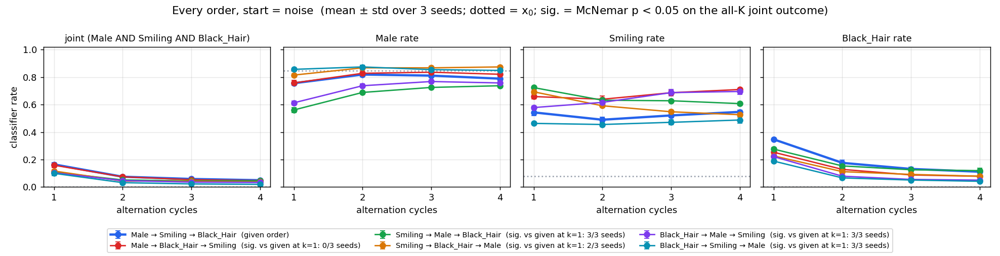

## Setup

| | |
|---|---|
| Classes | Male, Smiling, Black_Hair (a compatible triple, as in `experiments/method2_alternating/triple_eval.py`); controls swap the third class for Eyeglasses or ¬Young |
| Checkpoints (default) | `Male_500_withsamples/ckpt_0075`, `Smiling_paper500/ckpt_0025`, `Black_Hair_200/ckpt_0150` (the RESULTS.md projector set; epoch 150 is Black_Hair's peak edit rate), `Eyeglasses_200/ckpt_0025`, `Young_500/ckpt_0075` |
| Steps | Plain alternation, no relaxation. 1–4 full cycles. |
| References from the same x₀ | Each single net, and the 2-way alternation of the first two classes |
| Judge | `classifier/classifier.pt`; a feature counts when p > 0.5 (p < 0.5 for ¬Young) |
| Noise start | FFT-matched noise from `Male_500_withsamples/ckpt_0075` stats in every run, so every order, feature set and checkpoint set sees **identical x₀** |
| Real-face start ("none") | CelebA **test** faces that have none of the three features (4,115 available for the default triple) |
| Scale | 512 samples × 3 seeds; tables give the mean over seeds. BatchNorm uses batch statistics in chunks of 256, as in every other experiment in the repo. |
| Statistics | Orders are compared per image with an exact **McNemar test** on the all-3 joint outcome against Male → Smiling → Black_Hair (same x₀, so the test is paired) |

**`Young_500` is a ¬Young projector.** Its checkpoint args say `attr_spec: ~Young`,
and it lowers the classifier's Young rate (from noise 0.65 → 0.45). This study
treats it as ¬Young. Earlier scripts that score it as "Young" are being
checked separately.

## Results: experiment 1, order

All-3 joint rate, Male + Smiling + Black_Hair. *sig.* = number of seeds
(of 3) where McNemar p < 0.05 against Male → Smiling → Black_Hair at 1 cycle.

| order | noise, 1 cycle | noise, 4 cycles | sig. | none, 1 cycle | none, 4 cycles |
|---|---|---|---|---|---|
| **Male → Smiling → Black_Hair** | **0.165** | 0.049 | — | 0.010 | 0.033 |
| Male → Black_Hair → Smiling | 0.159 | 0.046 | 0/3 | 0.017 | 0.021 |
| Smiling → Black_Hair → Male | 0.117 | 0.036 | 2/3 | 0.008 | 0.020 |
| Smiling → Male → Black_Hair | 0.108 | 0.045 | 3/3 | 0.005 | 0.027 |
| Black_Hair → Male → Smiling | 0.104 | 0.033 | 3/3 | 0.019 | 0.022 |
| Black_Hair → Smiling → Male | 0.100 | 0.020 | 3/3 | 0.013 | 0.015 |
| *single net only: f_Male / f_Smiling / f_Black_Hair* | *0.17 / 0.13 / 0.29* | | | *0.02 / 0.01 / 0.00* | |

From noise, each pair of rows with the same first net looks almost the same:
the first net decides the face, and the other two only edit it.

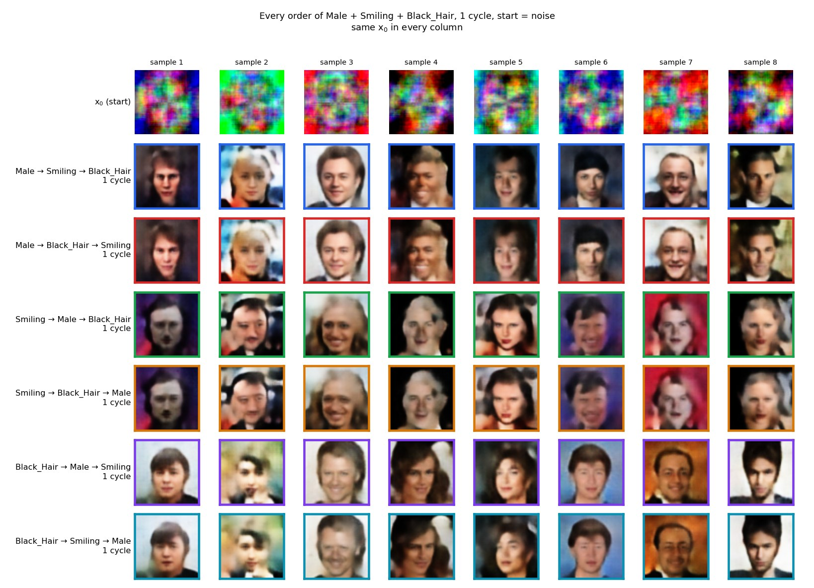

<details>
<summary><b>Every order from real faces ("none")</b></summary>

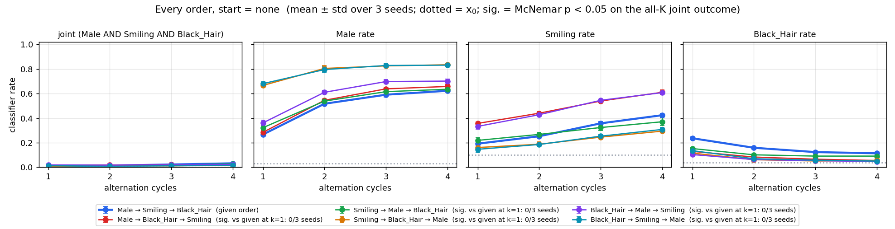
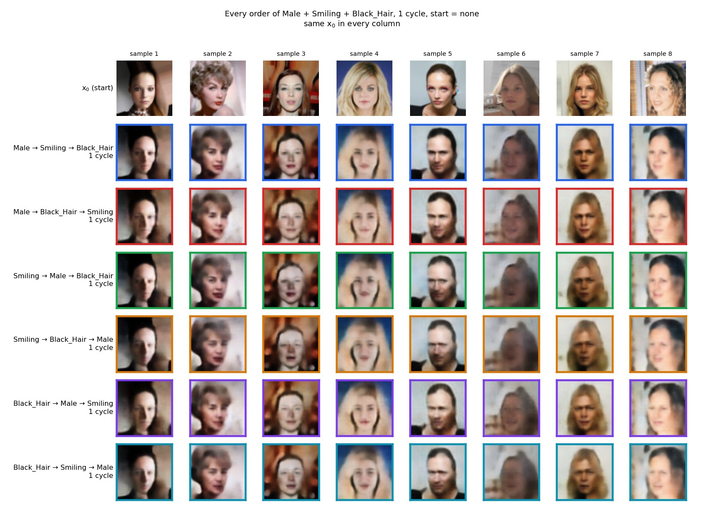
</details>

## Results: experiment 2, is it K or is it Black_Hair?

Joint rate over all the listed classes, after 1 cycle (4 cycles in brackets).

| classes | noise | none |
|---|---|---|
| Male + Smiling (2-way) | 0.59 | 0.08 |
| Male + Black_Hair (2-way) | 0.46 (0.12) | 0.05 (0.06) |
| Smiling + Black_Hair (2-way) | 0.34 (0.16) | 0.06 (0.09) |
| **Male + Smiling + Black_Hair** | **0.17** (0.05) | **0.01** (0.03) |
| Male + Smiling + Eyeglasses | 0.05 (0.05) | 0.01 (0.04) |
| Male + Smiling + ¬Young | 0.23 (0.27) | 0.02 (0.15) ⚠ |

- Each Black_Hair pair works about as well as Male + Smiling does, so Black_Hair
  is not a broken projector. The drop comes from asking for a third feature.
- **Eyeglasses** erases the smile: after 1 cycle Male is 0.99 and Eyeglasses
  0.56, but Smiling falls to 0.07. RESULTS.md already notes that this IGN
  can't render thin frames; here it also overwrites the mouth.
- ⚠ **¬Young is the only triple whose rate rises with cycles, and that rise
  is an artefact.** By 2–3 cycles the faces are smeared and blotchy, and the
  classifier reads the damage as "not young". After 1 cycle the faces barely
  look older.

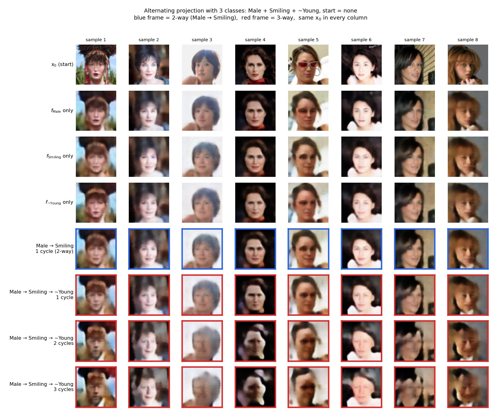

<details>
<summary><b>Pair and Eyeglasses grids</b></summary>

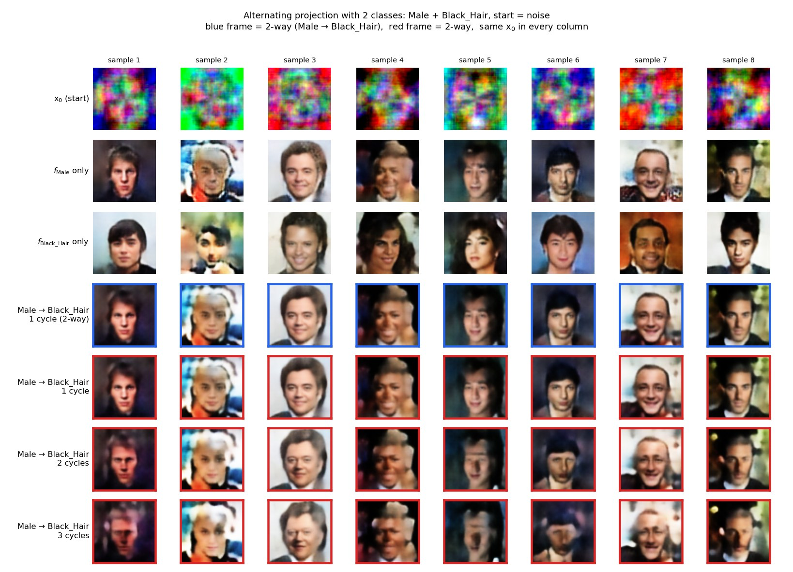
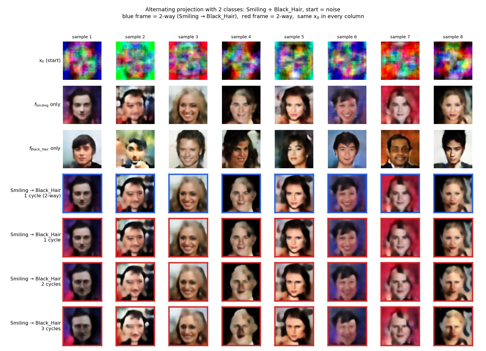
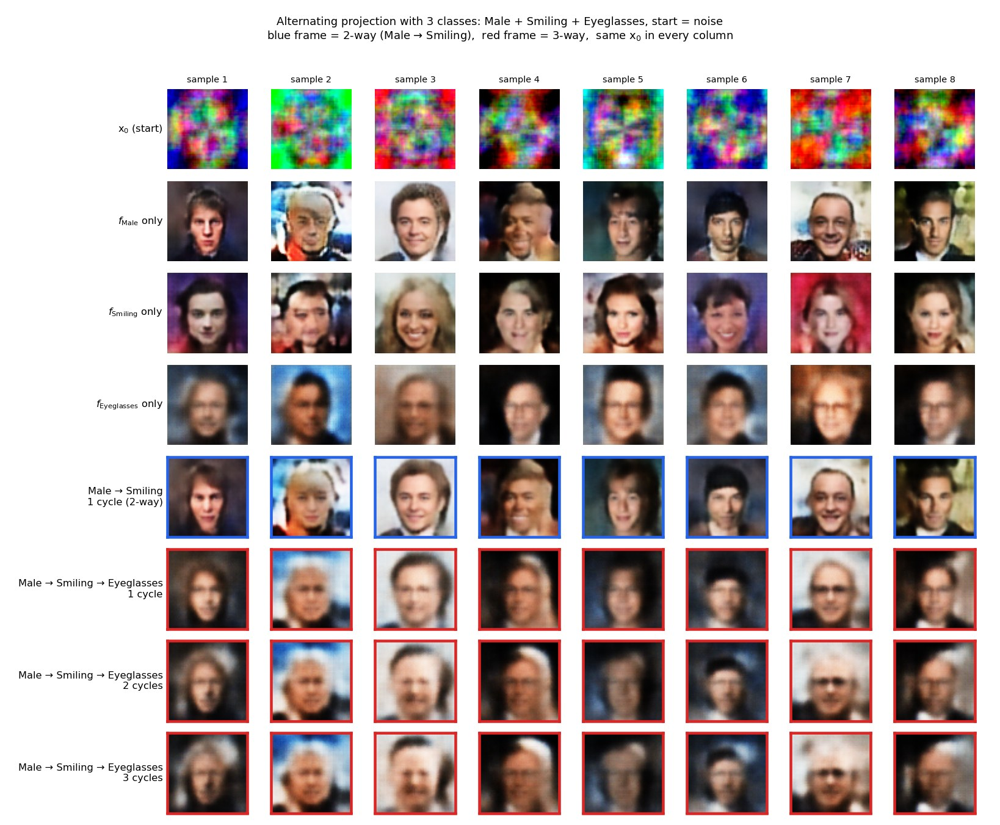
</details>

## Results: experiment 3, checkpoints

Male + Smiling + Black_Hair, given order. Checkpoint epochs are listed as
Male / Smiling / Black_Hair; Black_Hair trained for only 200 epochs, so its
"late" checkpoint is epoch 125.

| set | epochs | noise, 1 cycle | noise, 4 cycles | none, 1 cycle | 2-way Male + Smiling, noise, 1 cycle |
|---|---|---|---|---|---|
| default | 75 / 25 / 150 | 0.165 | 0.049 | 0.010 | 0.59 |
| early | 75 / 25 / 25 | 0.163 | 0.042 | 0.007 | 0.59 |
| late | 300 / 325 / 125 | 0.145 | 0.018 | 0.003 | 0.47 |
| last | 499 / 499 / 199 | 0.165 | 0.015 | 0.004 | 0.48 |

<details>
<summary><b>Rates per checkpoint set</b></summary>

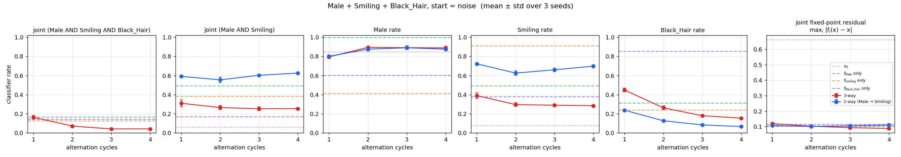
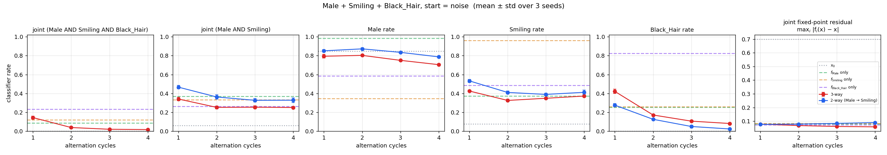
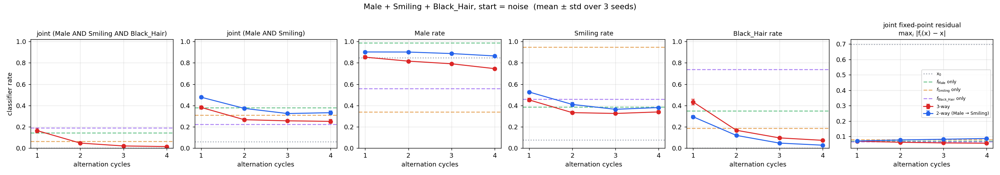
</details>

## Default order, start by start

These are the first runs (Male → Smiling → Black_Hair), with the per-attribute
rates, the 2-way reference and the joint fixed-point residual:

| start | grid | rates |
|---|---|---|
| noise | [grid](../results/method2_alternating/multi_class/default_order/noise/grid.jpg) | [rates](../results/method2_alternating/multi_class/default_order/noise/rates.png) |
| none (no Male, Smiling or Black_Hair) | [grid](../results/method2_alternating/multi_class/default_order/none/grid.jpg) | [rates](../results/method2_alternating/multi_class/default_order/none/rates.png) |
| real (any test face) | [grid](../results/method2_alternating/multi_class/default_order/real/grid.jpg) | [rates](../results/method2_alternating/multi_class/default_order/real/rates.png) |

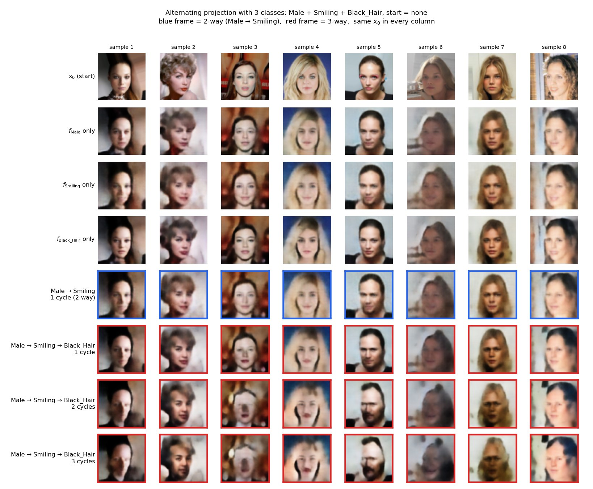

## Findings

1. **The joint rate is the product of the per-feature rates.** This holds in
   every order, checkpoint set, feature set and start tested, usually within
   ±0.02:

   | condition | all-K joint | product of per-feature rates |
   |---|---|---|
   | M+S+BH, noise, 1 cycle | 0.165 | 0.143 |
   | M+S+BH, noise, 4 cycles | 0.049 | 0.048 |
   | M+BH, noise, 1 cycle | 0.455 | 0.432 |
   | S+BH, noise, 1 cycle | 0.340 | 0.340 |
   | M+S+BH, last ckpts, noise, 1 cycle | 0.165 | 0.168 |
   | M+S+BH, none, 1 cycle | 0.010 | 0.012 |

   So whether one feature lands tells you nothing about whether the others
   do. The iteration isn't steering toward the intersection, and the joint rate
   falls multiplicatively with each added class. That is why K = 3 fails while
   compatible pairs work, and why it isn't fixed by order or checkpoints.
2. **More cycles make it worse from noise.** The all-3 joint falls from 0.17
   to 0.05 over 4 cycles, mostly because Black_Hair falls from 0.35 to 0.11:
   the other two nets keep undoing the hair. Later checkpoints decay faster
   (0.165 → 0.015 with the last set).
3. **The joint fixed-point residual keeps falling while the joint rate stays
   low** (0.097 → 0.075 from noise). The iteration settles on images that all
   three nets nearly leave unchanged but that aren't in the intersection. The
   nets are only approximately idempotent, so their near-fixed sets are
   broad and overlap outside the true target.
4. **From noise the first net decides the face, as in the order experiment.**
   Order changes the joint rate by up to 6.5 points: Male first is best,
   Black_Hair first is worst (significant on 3/3 seeds). A feature is most
   likely to survive when its net goes **last**: Black_Hair rate 0.28–0.35 when
   last vs 0.19–0.25 otherwise, Male rate 0.81–0.86 when last vs 0.56–0.61 in
   the middle.
5. **From real faces nothing works and order doesn't matter.** Every order
   gives 0.005–0.02 after 1 cycle, with no consistent significance. Already
   the 2-way pairs reach only 0.05–0.08 from these faces, matching RESULTS.md's
   real-image-editing result: the nets nudge a photo rather than reproject it.
6. **Adding the third class costs the first two.** Male & Smiling falls from
   0.59 (2-way) to 0.41 (3-way) from noise, and from 0.35 to 0.24 after 4
   cycles from real faces.

Relaxed steps are what make K = 3 work in RESULTS.md (0.31 from noise, then
selection). Plain cyclic alternation does not extend past two classes.

## Reproducing

The real-face starts need the CelebA **test** split only (19,962 images,
about 1.2 GB). Download the three `test-*.parquet` files from the Hugging
Face mirror
[`flwrlabs/celeba`](https://huggingface.co/datasets/flwrlabs/celeba/tree/main/img_align%2Bidentity%2Battr)
into `data/hf_celeba/`, then:

```bash
pip install "pyarrow==18.1.0"   # newer pyarrow requires NumPy 2
python -m scripts.celeba_from_hf "data/hf_celeba/test-*.parquet" --out data
```

Every run below takes 3–10 minutes on CPU. Each writes `results.json`,
`samples.pt`, `grid.png` and `rates.png` (plus `orders_*` with
`--all_orders`) to `--out`. Add `--init none` for the real-face start.

```bash
R="python -m experiments.method2_alternating.multi_class_experiment --runs_dir runs"
$R --all_orders --out exp_results/multi_class/orders_noise                         # experiment 1
$R --features Male Black_Hair --out exp_results/multi_class/pair_Male_Black_Hair_noise   # experiment 2
$R --features Smiling Black_Hair --out exp_results/multi_class/pair_Smiling_Black_Hair_noise
$R --features Male Smiling Eyeglasses --out exp_results/multi_class/triple_Eyeglasses_noise
$R --features Male Smiling "~Young" --out exp_results/multi_class/triple_NotYoung_noise
$R --out exp_results/multi_class/ckpt_last_noise \
   --ckpt Male=Male_500_withsamples/ckpt_0499.pt Smiling=Smiling_paper500/ckpt_0499.pt \
          Black_Hair=Black_Hair_200/ckpt_0199.pt                                   # experiment 3
```

Defaults are 512 samples, seeds 0 1 2, 4 cycles and BatchNorm chunks of 256.
Raw numbers for every run are in `results/method2_alternating/multi_class/<run>/<start>/results.json`.

## Not covered

- **FID.** Rates only. The script doesn't compute FID yet, although the
  test-set intersection images it would need are now available.
- **Relaxed steps on real faces.** `experiments/method2_alternating/triple_eval.py` tests relaxation from
  noise only.
- **Blond_Hair** (the anti-correlated feature): its checkpoints are not in
  the local `runs/`.
- **A trained 3-way baseline** (`f_Male∩Smiling∩Black_Hair`): it needs the
  train split and a GPU.
