# Does the order of application matter?

The alternating scheme composes two single-feature IGNs. For orthogonal
projections onto subspaces, von Neumann's theorem says the order is
irrelevant: `P_B P_A` and `P_A P_B` iterate to the same limit. IGNs are
non-linear and only approximately idempotent, so this experiment measures
what actually happens when the order is swapped:

- **Male → Smiling**: `x ← f_Smiling(f_Male(x))`
- **Smiling → Male**: `x ← f_Male(f_Smiling(x))`

## TL;DR

| question | from noise | from a real face |
|---|---|---|
| Do the two orders give the same image? | **No, never.** The first network decides the face; the second only edits it. | **Almost.** Both nets only nudge the photo, and the nudges nearly commute. |
| Does order change how often both features appear? | **Yes, and the winner depends on the checkpoint.** With the final checkpoints, **Male first** is better at every cycle count (0.48 vs 0.38 at 1 cycle). | Qualitatively no: neither order adds the features convincingly. |

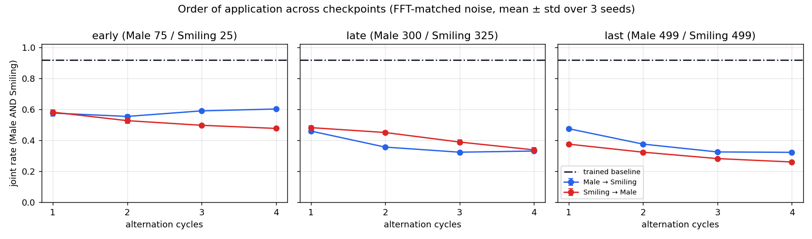

## Setup

| | |
|---|---|
| Feature pair | Male + Smiling (the headline pair in [RESULTS.md](RESULTS.md)) |
| Checkpoints, `Male_500_withsamples` / `Smiling_paper500` | **early** `ckpt_0075` / `ckpt_0025` (the RESULTS.md "projector stage") · **late** `ckpt_0300` / `ckpt_0325` · **last** `ckpt_0499` / `ckpt_0499` |
| Reference | trained baseline `Baseline_Male_AND_Smiling/ckpt_last` (joint rate 0.92) |
| Judge | `classifier/classifier.pt` |
| Noise start | FFT-matched noise, 1024 samples × 3 seeds, 1–4 cycles. Noise statistics come from `Male_500_withsamples/ckpt_0075` for every checkpoint set, so all three runs see **identical x₀**. |
| Real-face start | The 8 CelebA test faces with **neither Male nor Smiling** from the top row of [`real_image_editing_grid.png`](../results/method2_alternating/limits/real_image_editing_grid.png), cut from that image. Qualitative only (8 faces; BatchNorm statistics come from these 8). |
| BatchNorm | Batch statistics, as in every other experiment in the repo. |

**Controls.** Both orders always start from the same x₀ batch, so every
comparison is paired:
- The joint outcome is tested per image with an exact **McNemar test**.
- The distance between the two orders is judged against a **noise floor**: the
  same order run twice with the batch composition reshuffled. Batch-statistics
  BatchNorm alone moves outputs that much.

## Results: noise start

Joint rate (Male AND Smiling), mean over 3 seeds. **Bold** = significantly
better than the other order (McNemar p < 0.05 on at least 2 of 3 seeds).

| cycles | early, Male first | early, Smiling first | late, Male first | late, Smiling first | last, Male first | last, Smiling first |
|---|---|---|---|---|---|---|
| 1 | 0.576 | 0.582 | 0.460 | 0.482 | **0.475** | 0.375 |
| 2 | 0.554 | 0.527 | 0.356 | **0.451** | **0.376** | 0.324 |
| 3 | **0.590** | 0.497 | 0.324 | **0.389** | **0.325** | 0.282 |
| 4 | **0.602** | 0.477 | 0.331 | 0.339 | **0.323** | 0.260 |

| at 1 cycle | early | late | last |
|---|---|---|---|
| `f_Male` alone → joint | 0.48 | 0.38 | 0.38 |
| `f_Smiling` alone → joint | 0.35 | 0.31 | 0.30 |
| Male rate with **Smiling first** (does `f_Male` still add Male?) | 0.81 | 0.58 | **0.50** |
| Smiling rate with **Male first** (does `f_Smiling` still add a smile?) | 0.70 | 0.52 | 0.53 |
| SSIM of output to the **first** net's output | 0.76 | 0.87 | 0.87 |
| SSIM of output to the **second** net's output | 0.24 | 0.18 | 0.18 |
| L2 distance between the two orders | 61.9 | 73.2 | 72.6 |
| noise floor (same order, reshuffled batches) | 5.5 | 5.8 | 6.1 |
| per-image agreement on the joint outcome | 0.51 | 0.46 | 0.50 |

### Last checkpoints (epoch 499)

Every column starts from the same x₀. Blue frame = Male first, red frame =
Smiling first. Blue rows look like the `f_Male` row, and red rows look like the
`f_Smiling` row.

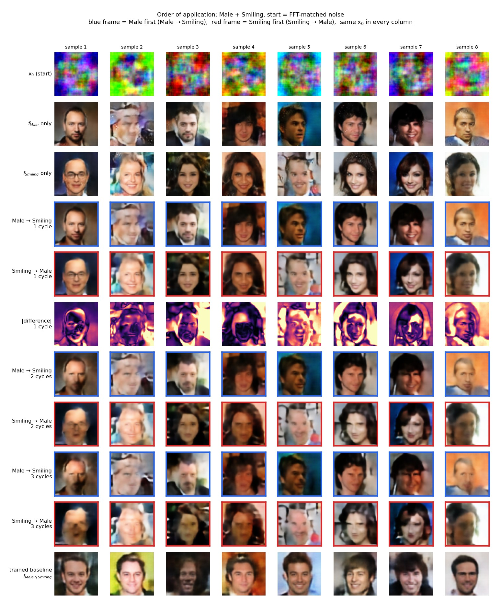
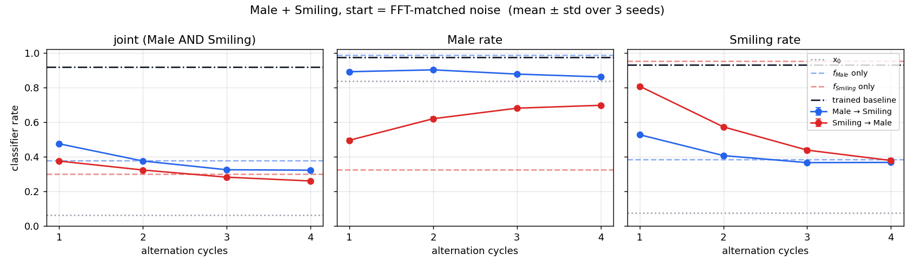

<details>
<summary><b>Late checkpoints (epochs 300 / 325)</b></summary>

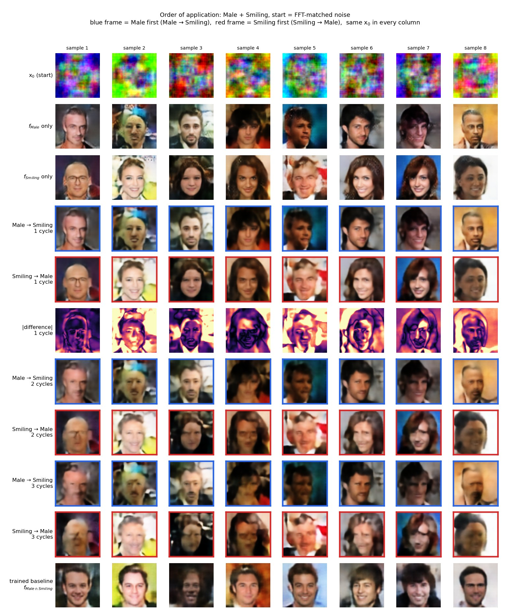
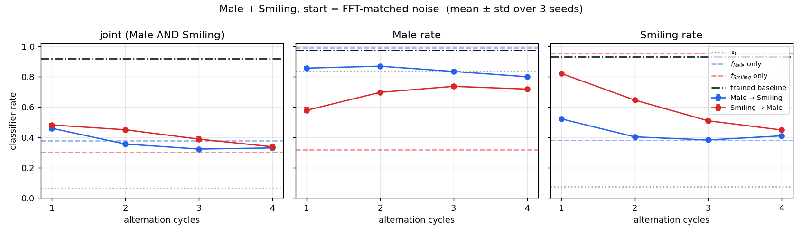
</details>

<details>
<summary><b>Early checkpoints (epochs 75 / 25)</b></summary>

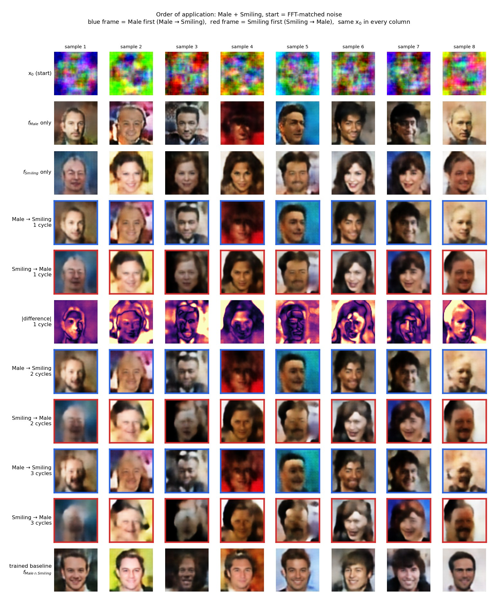
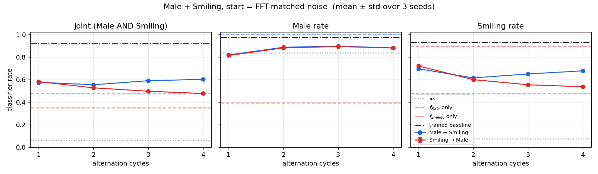
</details>

<details>
<summary><b>Distance between the orders vs the noise floor</b></summary>

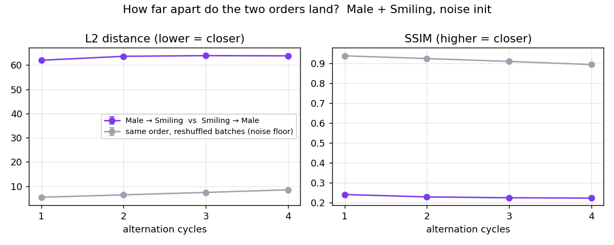
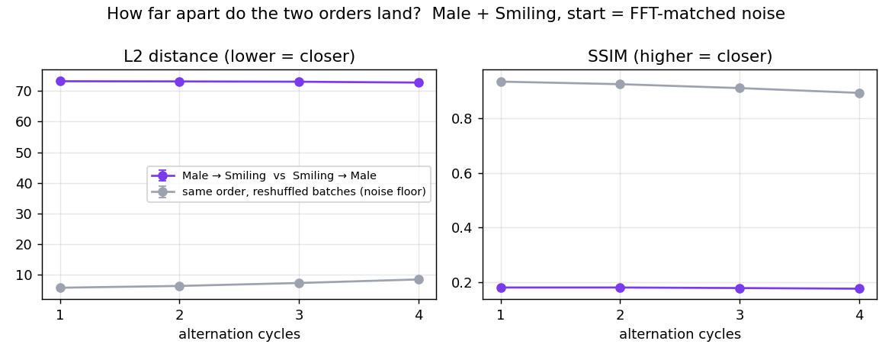
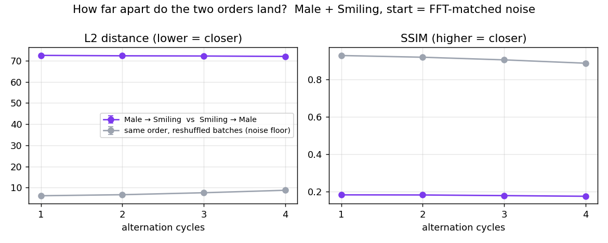
</details>

## Results: real CelebA faces

| cycles | L2 between orders, early | late | last |
|---|---|---|---|
| 1 | 12.3 | 8.1 | 8.4 |
| 2 | 12.8 | 9.0 | 9.5 |
| 3 | 13.4 | 10.3 | 11.5 |

That's 5–9× smaller than from noise. The |difference| row, on the same
colour scale as the noise grids, is almost black.

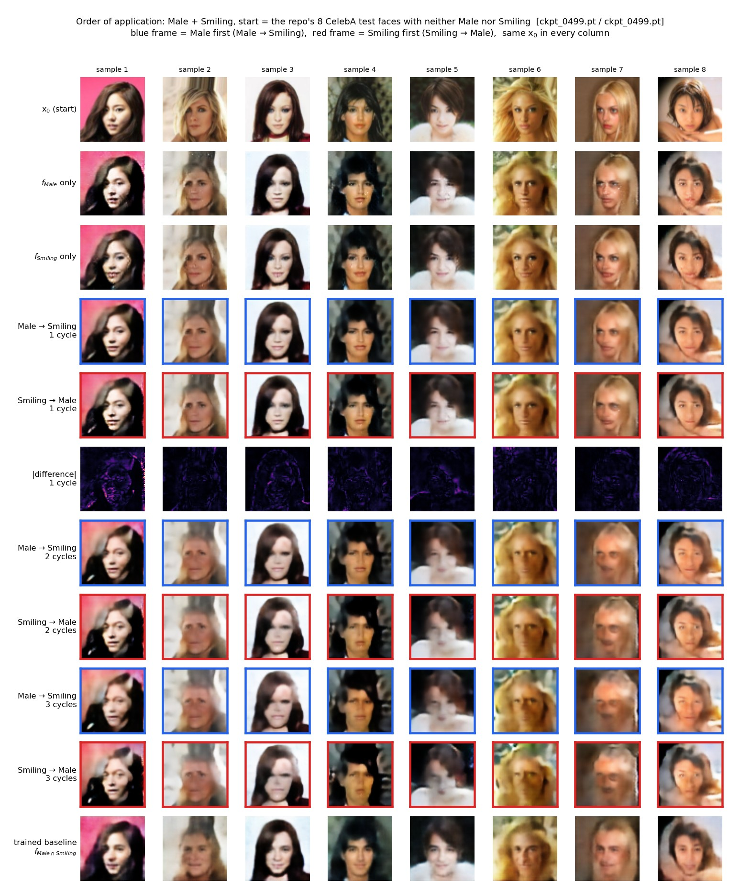

<details>
<summary><b>Late and early checkpoints</b></summary>

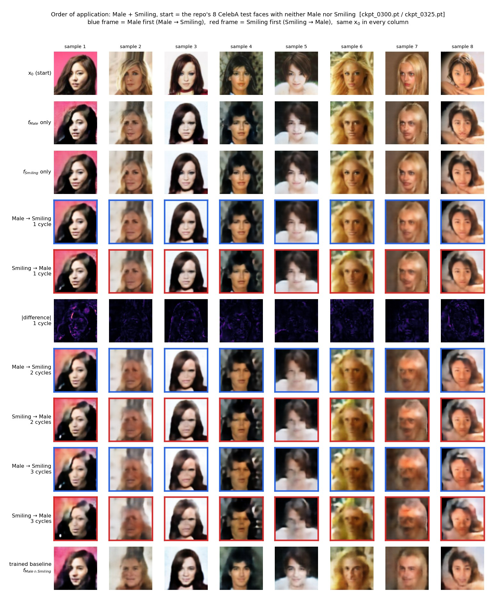
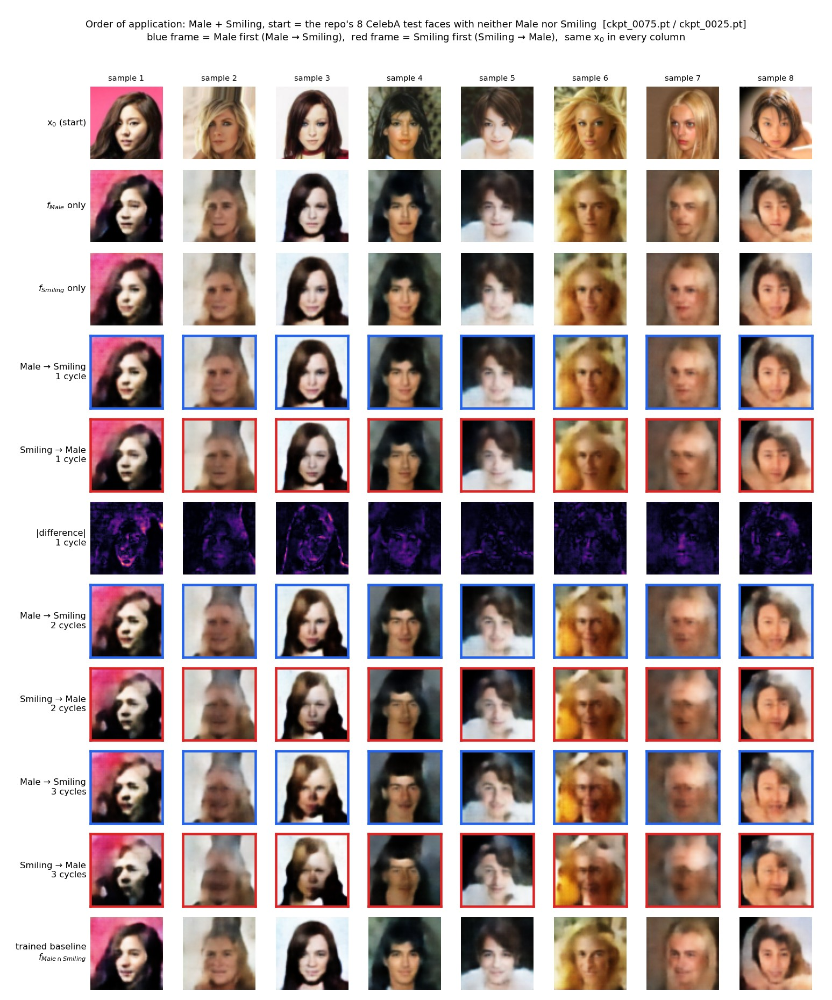
</details>

## Findings

1. **From noise, the first network decides the face.** After one cycle, the
   output is nearly the first net's output (SSIM 0.76–0.87) and far from the
   second's (about 0.2). Once a face exists, the second network treats it as
   nearly a fixed point and edits it only slightly.
2. **From noise, the orders never converge to the same image.** They stay 62–73 L2
   apart, about 10× the noise floor, at every cycle count. There is no common
   limit, unlike true projections.
3. **From a real face, order barely matters after one cycle.** Both nets only
   nudge the photo, and the nudges nearly commute (L2 8–12). The orders drift
   apart slowly with more cycles, along with growing blur. Neither order adds
   Male or Smiling convincingly to these faces, matching RESULTS.md's
   real-image-editing result.
4. **Which order wins depends on the checkpoint.**
   - *early*: tie at 1 cycle; Male first wins from cycle 3 on (0.60 vs 0.48
     at k=4), as in RESULTS.md law 3.
   - *late*: tie at 1 cycle; Smiling first wins at cycles 2–3.
   - *last*: **Male first wins at every cycle count**, by 10 points at 1
     cycle (p < 1e-4 on all seeds). The final Male net produces men 99% of
     the time when it generates, but barely changes a face it didn't make
     (Male rate 0.50 when applied second). The Smiling net still adds a smile
     to about half of the faces it is given. **Rule of thumb: the network that
     is the weaker *editor* should go first, where it acts as the generator.**
5. **Equal rates don't mean the same images.** Even where the joint rates tie,
   whether a given x₀ lands in the intersection agrees between the orders only
   46–51% of the time, close to chance.
6. **Later checkpoints look better but compose worse.** Single-net images are
   much sharper (the final Male net adds a few speckle artifacts), but each net
   edits the other's faces less. The best 1-cycle joint rate falls from 0.58
   (early) to 0.48 (late and last). This is RESULTS.md law 1 seen from the
   order angle.
7. **No order with any checkpoint gets near the trained baseline** (0.92).

## Reproducing

Place the checkpoints under `runs/` with their training-run folder names, then:

```bash
# noise start: one run per checkpoint set (writes exp_results/<out>/results.json + samples)
python -m experiments.method2_alternating.order_experiment --pairs Male,Smiling --inits noise --skip_fid \
    --noise_stats Male_500_withsamples/ckpt_0075.pt --out exp_results/order_experiment
python -m experiments.method2_alternating.order_experiment --pairs Male,Smiling --inits noise --skip_fid \
    --noise_stats Male_500_withsamples/ckpt_0075.pt --out exp_results/order_late_noise \
    --ckpt Male=Male_500_withsamples/ckpt_0300.pt Smiling=Smiling_paper500/ckpt_0325.pt
python -m experiments.method2_alternating.order_experiment --pairs Male,Smiling --inits noise --skip_fid \
    --noise_stats Male_500_withsamples/ckpt_0075.pt --out exp_results/order_last_noise \
    --ckpt Male=Male_500_withsamples/ckpt_0499.pt Smiling=Smiling_paper500/ckpt_0499.pt
python -m experiments.method2_alternating.make_order_figures --res exp_results/order_last_noise      # grid, rates, distance
python -m experiments.method2_alternating.make_order_figures --compare "early=exp_results/order_experiment" \
    "late=exp_results/order_late_noise" "last=exp_results/order_last_noise"

# real-face start: the repo's 8 faces, no dataset needed
python -m experiments.method2_alternating.order_grid_from_png --tag last \
    --ckpt Male=Male_500_withsamples/ckpt_0499.pt Smiling=Smiling_paper500/ckpt_0499.pt
```

Defaults are 1024 samples, seeds 0 1 2, 4 cycles, and BatchNorm chunks of 256.
Raw numbers for the three noise runs are in `results/method2_alternating/order_experiment/noise/*_results.json`.
With CelebA in `data/celeba/`, `experiments/method2_alternating/order_experiment.py --inits neither only_A only_B`
runs the real-photo start at full scale.
[`scripts/celeba_from_hf.py`](../scripts/celeba_from_hf.py) builds that folder
from the Hugging Face mirror when torchvision's Google Drive download is
rate-limited.

## Not covered

- **Male + Blond_Hair** (the anti-correlated pair) needs the `Blond_Hair_500` checkpoints.
- Real-face statistics at scale (1024 photos); here, 8 faces, qualitative.
